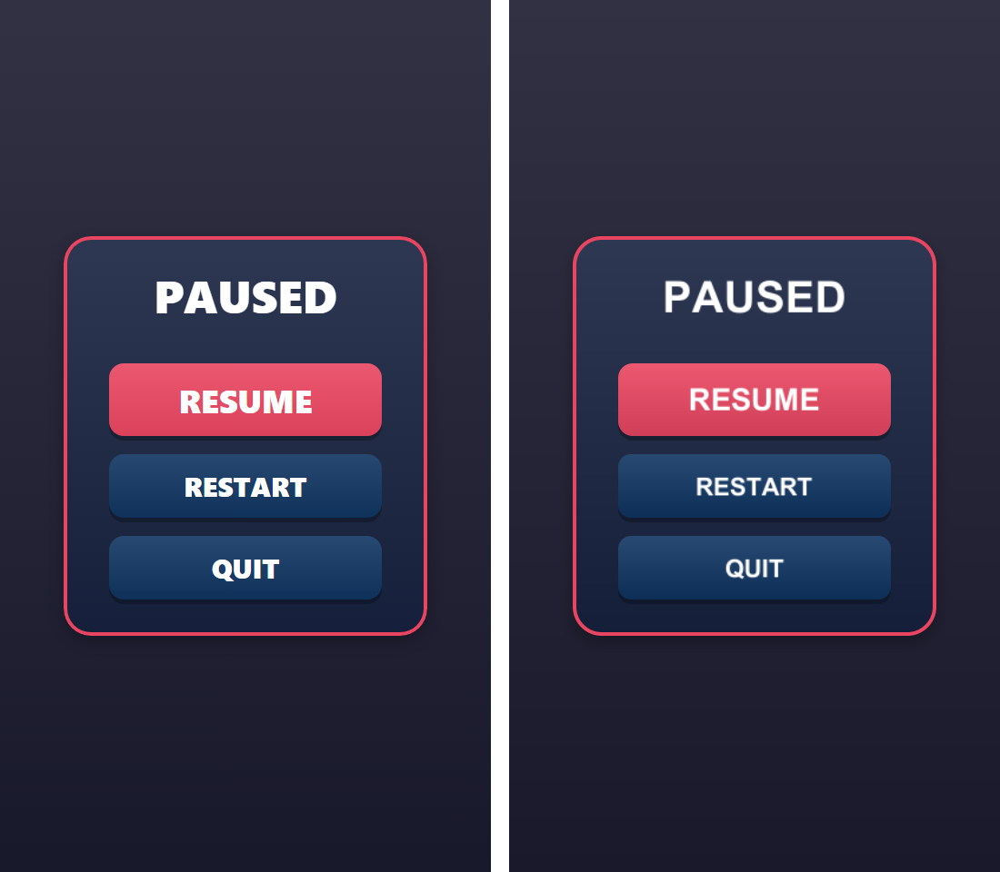

# Mockup to Unity UI: an agent that lays out game screens

Give Claude Code a picture of a game screen. It builds the screen in Unity as a real uGUI prefab, renders it, compares the render with the picture and fixes what is off.



The work this replaces is common in mobile game studios: a designer hands over a mockup and a developer rebuilds it by hand, panel by panel. The agent does the first pass, names every object, anchors it to the right edge of the screen and saves a prefab the developer can keep working on.

## How it works

```
mockup.png ──> Claude Code + skill ──> layout spec (JSON) ──> MCP server ──> Unity editor bridge
                    ^                                                            │
                    └──── compare_to_mockup: similarity, worst regions, diff <── screenshot
```

- **Unity editor bridge** (`UnityProject/Assets/UiAgent/Editor`): a local HTTP endpoint inside the editor. It turns the spec into a Canvas with panels, buttons, text, circles and progress bars, anchors each element to the nearest screen edge and saves a prefab. Rounded corners, inner borders and soft shadows come from generated 9-sliced sprites saved as assets, and gradients from a small vertex-color effect (`UiVerticalGradient`), so the prefab has no extra draw calls for styling. It renders the canvas at its exact size. Works with the editor open, or headless (`-batchmode -executeMethod UiAgent.UiAgentBridge.Serve`).
- **MCP server** (`mcp/server.mjs`, no SDK, stdio JSON-RPC): tools `unity_build_ui`, `unity_screenshot`, `unity_hierarchy`, `compare_to_mockup`. The same tools are available as a CLI (`mcp/cli.mjs`) for scripts and CI.
- **Skill** (`.claude/skills/mockup-to-unity-ui/SKILL.md`): the spec format and the loop the agent follows: read the mockup, measure, build, screenshot, compare, fix, at most three rounds.

## Evaluation

Ten mobile game screens (main menu, shop, inventory, pause, leaderboard, battle HUD and others), 540×960. Each mockup was drawn by a browser with designer styling (another font, gradients, soft shadows), so it does not look like Unity's own output. The ground-truth layout of every screen is known.

Each run used a fresh Claude Code subagent with only the skill and the tools. Ground truth was moved out of the repository during the runs. An agent element counts as found when its box overlaps the true element with IoU ≥ 0.5 and the type matches.

| Metric | v1 | v2 |
|---|---|---|
| Elements found (recall) | 96.6% | **97.3%** |
| Agent elements that are real (precision) | 84.8% | **98.2%** |
| Elements built, ground truth has 106 | 122 | **105** |
| Mean box overlap (IoU) | 0.92 | 0.93 |
| Mean center error | 1.7 px | 1.9 px |
| Text exactly right | 96.3% | 94.3% |
| Color similarity | 96.5% | 95.3% |
| Pixel similarity, render vs mockup | 98.2% | **99.1%** |

Per screen: [v1](eval/runs/agent_v1/score.md), [v2](eval/runs/agent_v2/score.md). What the agent changed between rounds: [v1 log](eval/runs/agent_v1/log.md), [v2 log](eval/runs/agent_v2/log.md). Each run took 6 to 8 minutes for all ten screens of agent time (v2 lost about 9 minutes more to a network outage on one screen).

### What v1 showed and what changed in v2

- **v1 built 122 elements for 106 real ones.** The agent imitated shadows and borders with extra panels. Half of that came from the builder: `outline` was drawn outside the box with square corners, so the agent worked around it with a border panel and an inset panel.
- **v2 fixed the tool and the instructions, not the agent.** The builder got an inner border that follows rounded corners, soft drop shadows and vertical gradients. The skill now says that one visual object is one element and styling goes into fields. Precision went from 84.8% to 98.2%, and the prefab has as many objects as the design.
- **Pixel similarity is a weak signal on its own.** The exact ground-truth layout, which has no gradients or shadows, scores 97.6%. v2 scores higher than that because it reproduces the styling. The main metrics compare the layout element by element.
- **Color similarity dropped slightly in v2** because a gradient's top color is compared with the flat color in the ground truth. It is a metric artifact, not a worse match.
- **Most of the quality comes before the first build.** In both runs the agent wrote its own pixel-measuring helpers (connected regions, text bounding boxes). Later rounds were mostly font sizes and gradient end colors.

### Known gaps

- Off-center highlights on orbs and the mockup's heavier font cannot be reproduced. Button labels sit about 3 px higher than in the mockup, and text has no shadow yet.
- On 02_level_complete the agent merged a title into its ribbon, so two text elements did not match.
- During the v2 run the agent once ran `eval/score.mjs` without arguments by mistake. Ground truth was not in the folder, so it failed immediately and showed nothing.

## Run it

Requirements: Unity 6 (tested on 6000.3.23f1), Node 20+, Claude Code.

```bash
cd mcp && npm install && cd ..
# open UnityProject in the Unity editor (the bridge starts on 127.0.0.1:8790), or headless:
Unity.exe -batchmode -projectPath UnityProject -executeMethod UiAgent.UiAgentBridge.Serve
claude   # .mcp.json registers the server; ask: "build eval/dataset/mockups/03_shop.png in Unity"
```

Score a run: `node eval/score.mjs eval/runs/<run>` (expects `specs/` and `renders/`). Ground truth is in `eval/dataset/ground_truth`, and `eval/gen_dataset.mjs` regenerates the mockups. `eval/runs/oracle` is the ground truth rendered through the same pipeline.

## Limits

- uGUI with legacy Text. TextMeshPro and Auto Layout groups are not generated yet.
- Icons and illustrations become colored placeholders, because the spec has no image assets.
- Ten screens is a small test set, and every screen is built from simple shapes.
