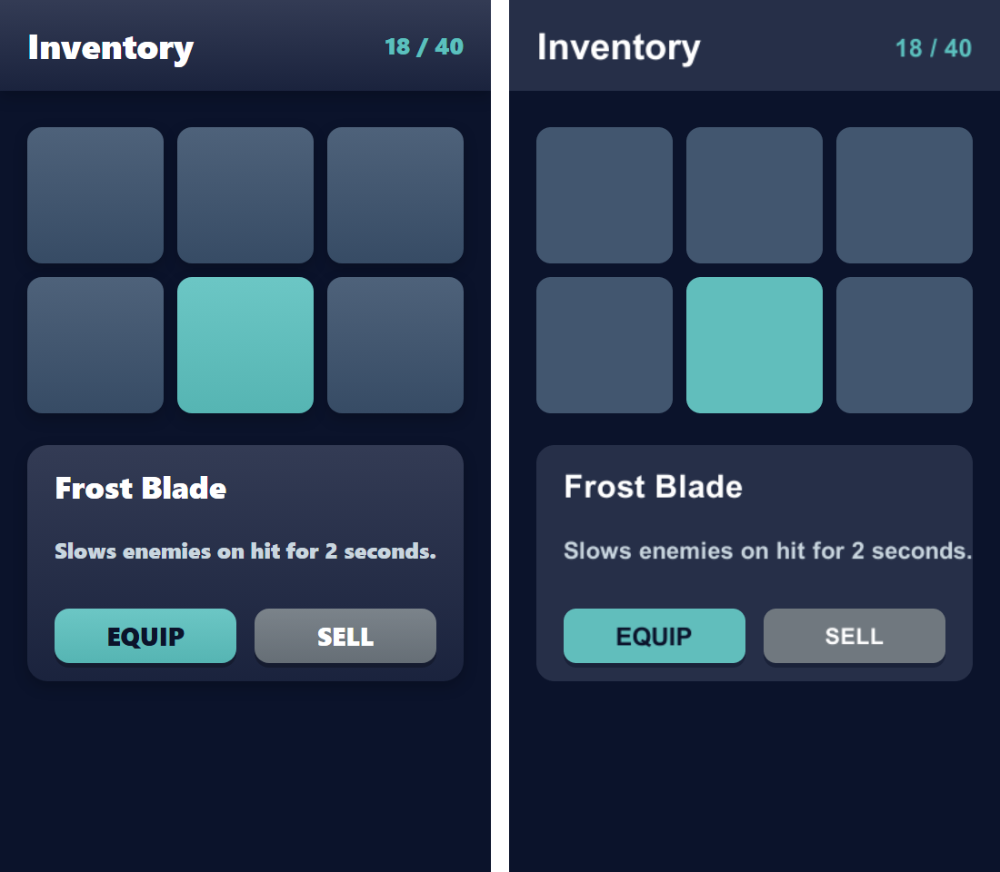

# Mockup to Unity UI: an agent that lays out game screens

Give Claude Code a picture of a game screen. It builds the screen in Unity as a real uGUI prefab, renders it, compares the render with the picture and fixes what is off.



The work this replaces is common in mobile game studios: a designer hands over a mockup and a developer rebuilds it by hand, panel by panel. The agent does the first pass, names every object, anchors it to the right edge of the screen and saves a prefab the developer can keep working on.

## How it works

```
mockup.png ──> Claude Code + skill ──> layout spec (JSON) ──> MCP server ──> Unity editor bridge
                    ^                                                            │
                    └──── compare_to_mockup: similarity, worst regions, diff <── screenshot
```

- **Unity editor bridge** (`UnityProject/Assets/UiAgent/Editor`): a local HTTP endpoint inside the editor. It turns the spec into a Canvas with panels, buttons, text, circles and progress bars, anchors each element to the nearest screen edge, generates rounded-corner sprites as assets, saves a prefab and renders the canvas at its exact size. Works with the editor open, or headless (`-batchmode -executeMethod UiAgent.UiAgentBridge.Serve`).
- **MCP server** (`mcp/server.mjs`, no SDK, stdio JSON-RPC): tools `unity_build_ui`, `unity_screenshot`, `unity_hierarchy`, `compare_to_mockup`. The same tools are available as a CLI (`mcp/cli.mjs`) for scripts and CI.
- **Skill** (`.claude/skills/mockup-to-unity-ui/SKILL.md`): the spec format and the loop the agent follows: read the mockup, measure, build, screenshot, compare, fix, at most three rounds.

## Evaluation

Ten mobile game screens (main menu, shop, inventory, pause, leaderboard, battle HUD and others), 540×960. Each mockup was drawn by a browser with designer styling (another font, gradients, soft shadows), so it does not look like Unity's own output. The ground-truth layout of every screen is known.

The agent was a fresh Claude Code subagent with only the skill and the tools. Ground truth was moved out of the repository during the run. It processed all ten screens in about 6.5 minutes, using 2 to 3 build rounds per screen.

An agent element counts as found when its box overlaps the true element with IoU ≥ 0.5 and the type matches.

| Metric | Result |
|---|---|
| Elements found (recall) | **96.6%** |
| Agent elements that are real (precision) | 84.8% |
| Mean box overlap (IoU) | 0.92 |
| Mean center error | **1.7 px** |
| Text exactly right | 96.3% |
| Color similarity | 96.5% |
| Pixel similarity, render vs mockup | 98.2% (the ground-truth layout itself scores 97.6% on this metric) |

Per screen: [`eval/runs/agent_v1/score.md`](eval/runs/agent_v1/score.md). What the agent changed between rounds: [`eval/runs/agent_v1/log.md`](eval/runs/agent_v1/log.md).

### What the numbers showed

- **Pixel similarity is a weak signal.** Even the exact ground-truth layout scores 97.6%, because gradients and shadows can't be reproduced. That is why the main metrics compare the layout itself, element by element.
- **Precision is lower than recall** because the agent added extra panels to imitate drop shadows and borders. Half of that came from a builder limitation: `outline` is drawn outside the box with square corners, so the agent worked around it with a border panel and an inset panel. The fix belongs in the builder (inner, rounded outline) and in the skill (do not imitate shadows), not in the agent's judgment.
- **Rounds two and three changed little.** The agent wrote its own pixel-measuring helpers (connected regions, text bounding boxes), so the first build was already within a few pixels. Most later edits were font sizes, and on two screens it reverted them when the score dropped.

## Run it

Requirements: Unity 6 (tested on 6000.3.23f1), Node 20+, Claude Code.

```bash
cd mcp && npm install && cd ..
# open UnityProject in the Unity editor (the bridge starts on 127.0.0.1:8790), or headless:
Unity.exe -batchmode -projectPath UnityProject -executeMethod UiAgent.UiAgentBridge.Serve
claude   # .mcp.json registers the server; ask: "build eval/dataset/mockups/03_shop.png in Unity"
```

Score a run: `node eval/score.mjs eval/runs/<run>` (expects `specs/` and `renders/`). Ground truth is in `eval/dataset/ground_truth`, and `eval/gen_dataset.mjs` regenerates the mockups. `eval/runs/oracle` is the ground truth rendered through the same pipeline, the upper bound for pixel similarity.

## Limits

- uGUI with legacy Text. TextMeshPro and Auto Layout groups are not generated yet.
- Icons and illustrations become colored placeholders, because the spec has no image assets.
- Ten screens is a small test set, and every screen is built from simple shapes.
